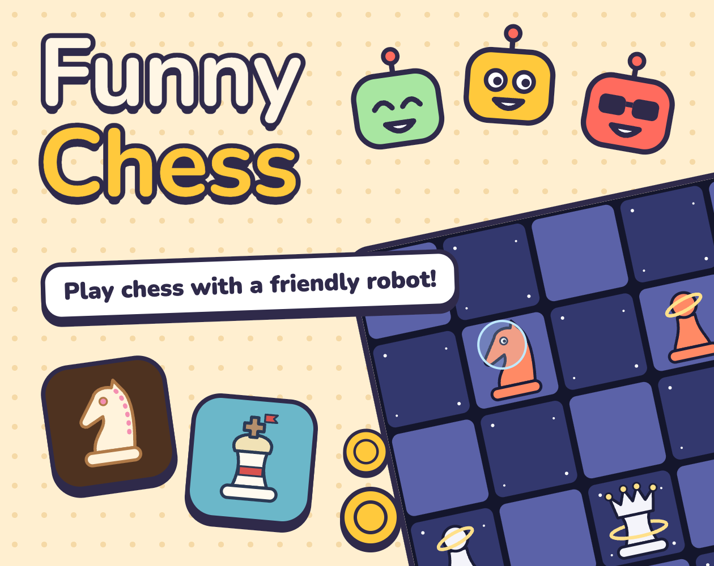
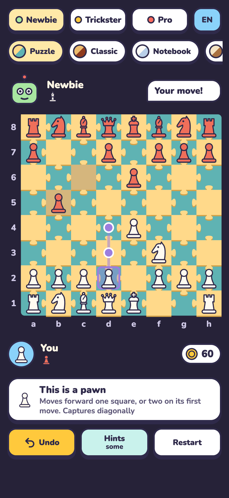
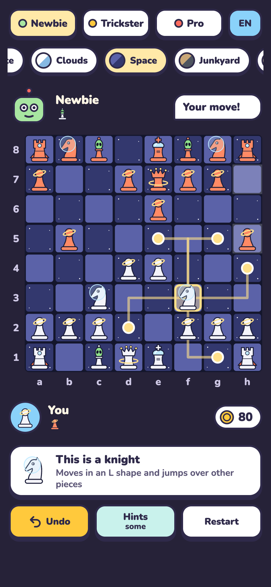
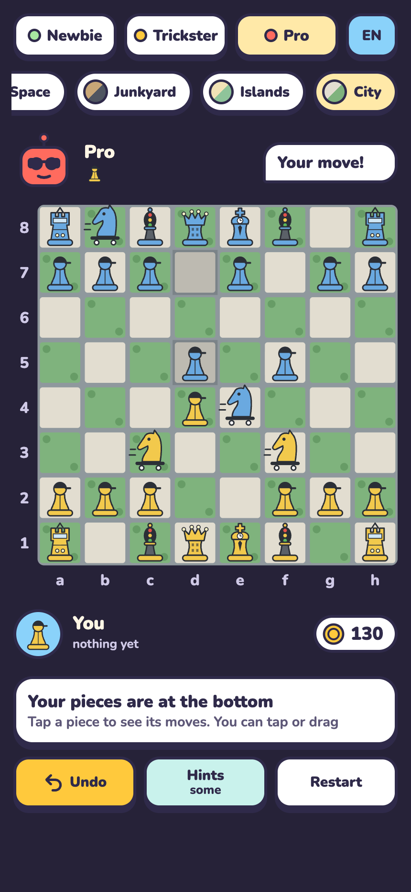
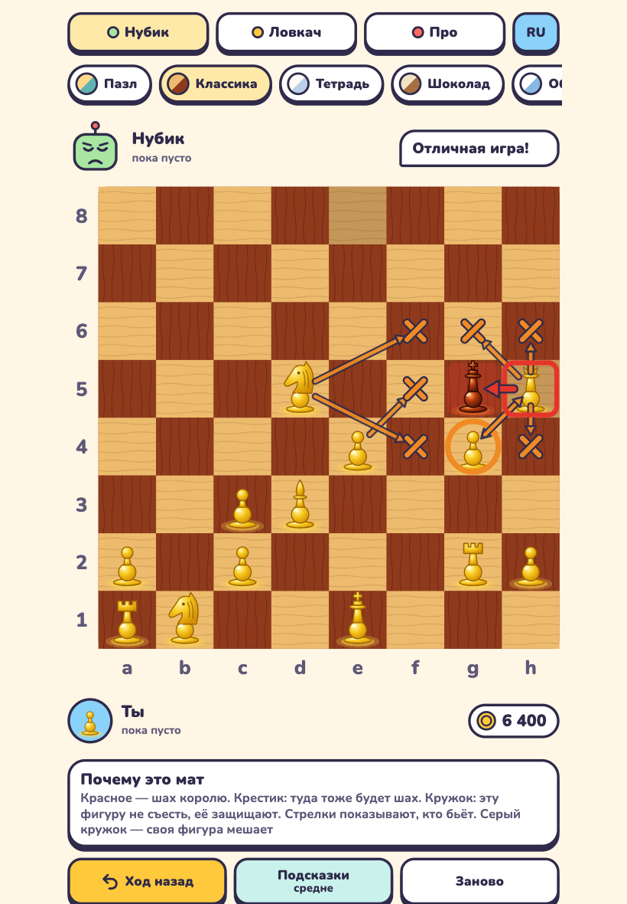
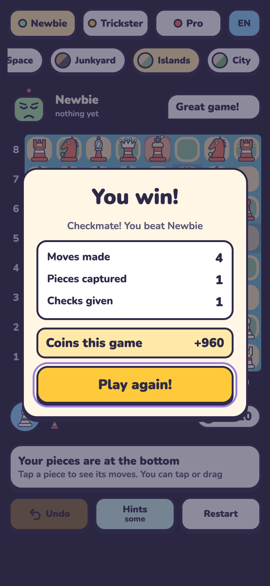

  

<h1 align="center">Funny Chess</h1>

<b>Chess for kids 6+ against friendly robots.</b> Free, in the browser, no sign-up.

  <a href="https://tslava.itch.io/funny-chess"><b>▶ Play free on itch.io</b></a>

---

## What it is

Funny Chess is a cheerful chess game for parents and teachers to share with kids. Open the page and the board is already there: no menus, no accounts. New players just tap a piece to see where it can go. Experienced players can take on the strongest robot and keep hints to a minimum.

  
  
  

## What's inside

- **Three robots.** Newbie (easy), Trickster (medium) and Pro (hard). They think out loud, react to your moves and never laugh at mistakes. In a hurry? Tap the robot and it moves at once.
- **Nine worlds.** Puzzle, Classic, Notebook, Chocolate, Clouds, Space, Junkyard, Islands and City. Switch at any time, even in the middle of a game.
- **Hints that teach.** Dots show where a piece can go, lines show how the knight jumps in an L, and at the highest level gold arrows suggest good moves.
- **Take back a move**, even after checkmate.
- **See why it is checkmate.** After the game, the board shows who gives check and which piece keeps the king off each square.
- **Coins** for moves, captures, checks, castling and promotion.
- **Full chess rules:** castling, en passant, promotion, check, checkmate and stalemate.
- **Several languages.** Made for phones and tablets held upright, works on computers too.

  
  

## For parents and teachers

- Age 6 and up. Children who don't know the rules yet learn them by tapping pieces.
- No ads, no accounts, no data collection. Coins and settings stay in the browser.
- Best on a tablet held upright.

## Who made it

A dad and his daughter made Funny Chess together, and her younger brother tested it and asked for more. It is our first game.

## What's new

- **1.1** — "See the board" after the game, with arrows that explain the checkmate. Tapping the robot now always makes it move at once. Bigger board on tablets.
- **1.0** — First release on itch.io.

## Ideas for later

- A "no hints" mode
- Sound
- Playing as black
- Something to spend coins on

## Feedback

Found something confusing for your kids, or a mistake in the texts? Please [open an issue](../../issues). Native speakers who can check our Polish are especially welcome.

## Credits

- Chess rules: [chess.js](https://github.com/jhlywa/chess.js) (BSD-2-Clause)
- Font: [Nunito](https://fonts.google.com/specimen/Nunito) (SIL Open Font License)
- Code and artwork were made with the help of AI tools.

---

This repository is a showcase page. The game itself is hosted on [itch.io](https://tslava.itch.io/funny-chess).
Images and texts © 2026 the Funny Chess authors. All rights reserved. See [LICENSE](LICENSE).
